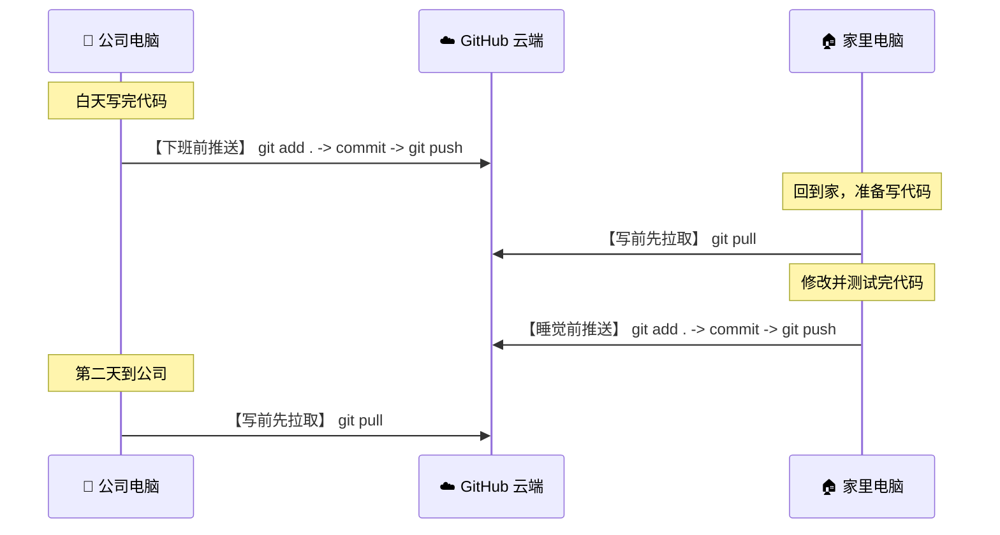

# Git 学习指南：从本地到远程的通俗教程

> [!NOTE]
> 本文档是为你量身定制的 Git 入门指南，记录了我们刚刚完成的每一部 Git 操作及其背后的原理。你可以随时通过这篇指南进行查阅和复习。

---

## 1. Git 的基本工作流程

在学习具体命令前，我们先用一张图来看看 Git 是如何管理你的代码的：

```mermaid
graph LR
    subgraph 本地电脑 (Local)
        A["工作区 (Working Directory)<br/>你在文件夹里看到的实际文件"] -->|git add| B["暂存区 (Staging Area)<br/>准备提交的临时缓存区"]
        B -->|git commit| C["本地仓库 (Local Repo)<br/>存在 .git 里的历史照片"]
    end
    subgraph 远程托管 (Remote)
        C -->|git push| D["GitHub 仓库 (GitHub Repo)<br/>保存在云端的备份"]
    end
    style A fill:#f9f,stroke:#333,stroke-width:2px
    style B fill:#bbf,stroke:#333,stroke-width:2px
    style C fill:#bfb,stroke:#333,stroke-width:2px
    style D fill:#fbb,stroke:#333,stroke-width:2px
```

---

## 2. 刚才我们用过的 Git 命令详解

我们刚刚在 `Typhoon` 项目里，一共使用了以下几组操作。为了帮助你理解，我将它们分为三个部分：

### 第一阶段：本地仓库初始化与提交

| 命令 | 通俗解释 | 我们刚才用它做了什么？ |
| :--- | :--- | :--- |
| **`git init`** | **“建立暗房”**：在当前文件夹里创建一个隐藏的 `.git` 文件夹，正式开启版本控制。 | 我们在 `Typhoon` 文件夹里执行了它，将其变成了一个 Git 仓库。 |
| **`git status`** | **“检查状态”**：查看哪些文件被修改了、哪些文件还没被 Git 记录。 | 我们用它确认了 `.gitignore`（忽略文件）是否生效，确保只有 `.ipynb` 被追踪。 |
| **`git add .`** | **“放入相机”**：把当前目录下所有未忽略的修改，塞入暂存区。 | 我们把 `.gitignore` 和你的 `.ipynb` 文件装进了“待提交”队列。 |
| **`git commit -m "说明"`** | **“按下快门”**：把暂存区的文件永久记录到本地仓库，并附带一句修改说明。 | 我们创建了第一个提交版本，留言为：`Initial commit with notebook`。 |

---

### 第二阶段：修改作者身份与隐私处理

因为你是在工作电脑上操作，但要推送到个人 GitHub，我们做了一些临时的隐私修改：

| 命令 | 通俗解释 | 为什么使用它？ |
| :--- | :--- | :--- |
| **`git config --local user.name "名字"`**<br>**`git config --local user.email "邮箱"`** | **“换上马甲”**：只修改当前项目里的提交者姓名和邮箱，不影响你电脑上的其他项目。 | 我们把你的作者身份改为了 `TronYolo` 和你的个人邮箱 `csxtron@gmail.com`。 |
| **`git commit --amend --reset-author --no-edit`** | **“重洗照片”**：用刚才新设置 of 个人身份，重写最新一次的提交记录，且不修改留言。 | 我们用它把刚刚带有公司邮箱的第一个提交记录，擦除改成了你的个人邮箱。 |

---

### 第三阶段：关联并推送到 GitHub 远程仓库

| 命令 | 通俗解释 | 我们刚才用它做了什么？ |
| :--- | :--- | :--- |
| **`git branch -M main`** | **“改名主线”**：将本地的默认分支名字由旧版 `master` 改为现代通用的 `main`。 | 确保与 GitHub 默认的 `main` 分支名称一致，防止推送时产生冲突。 |
| **`git remote add origin 链接`** | **“绑定云端”**：把本地仓库和 GitHub 上的线上空仓库地址连接起来。 | 我们将你的本地项目绑定到了 `https://github.com/TronYolo/Typhoon.git`。 |
| **`git remote set-url origin 链接(带Token)`** | **“插入临时钥匙”**：修改连接地址，把你的 Token（临时密码）直接塞进链接中。 | 我们把你的 Token 强行加入推送地址中，绕过了你电脑里默认的工作账户凭证。 |
| **`git push -u origin main`** | **“上传云端”**：把本地 `main` 分支的代码，推送到云端的 `origin`（即GitHub）上。 | 我们执行了上传，使你的 `.ipynb` 文件在 GitHub 上成功显示。 |

---

## 3. 日常最常用的 4 个黄金命令

以后你自己在电脑上开发时，最经常用到的只有这四个命令循环：

1. **`git status`**：写完代码，随时看一下改动了哪些文件。
2. **`git add .`**：把修改内容放入暂存区，准备提交。
3. **`git commit -m "这里写你的修改说明"`**：在本地保存一个版本。
4. **`git push`**：把本地保存的版本推送到 GitHub 云端。

---

## 4. 🏠 双机协作黄金循环（公司 ⇄ 家里）

当你在不同电脑上轮流做东西时，遵循以下开发循环：

### 第一天回家（首次配置）
因为家里电脑还没有该文件夹，你需要进行一次**克隆（下载）**：
```bash
# 在你喜欢的目录下运行，这会创建一个 Typhoon 文件夹
git clone https://github.com/TronYolo/Typhoon.git
```

### 之后的日常交替开发



* **公司下班前**：
  ```bash
  git add .
  git commit -m "在公司完成的工作说明"
  git push
  ```
* **回到家里后**：
  ```bash
  git pull
  git add .
  git commit -m "在家里完成的工作说明"
  git push
  ```
* **第二天回到公司**：
  ```bash
  git pull
  # 继续开发...
  ```
